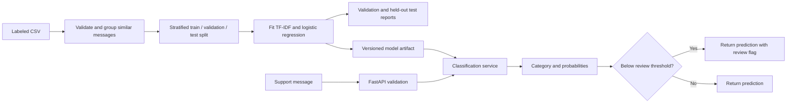

# SupportIQ

**Customer support classification with offline training and a local FastAPI service.**

SupportIQ predicts one category for a support message, returns the model's class probabilities, and flags uncertain predictions for human review. It runs on a CPU and makes no network calls for training or inference.

| At a glance | |
| --- | --- |
| Categories | `billing`, `technical_issue`, `account_access`, `order_or_service_request`, `general_inquiry` |
| Model | Word unigram/bigram TF-IDF + logistic regression |
| Training | Explicit offline command; never runs in the API process |
| API | Single and batch classification, model information, readiness |
| Data | Illustrative synthetic CSV; replace before real use |

## Quick start

Run these commands from this repository's root. Python 3.11 or newer is required.

**Windows PowerShell**

```powershell
py -3.11 -m venv .venv
.\.venv\Scripts\Activate.ps1
python -m pip install -e '.[dev]'
python scripts/train_model.py
uvicorn supportiq.main:app --host 127.0.0.1 --port 8000
```

Use `python -m venv .venv` if your installed Python is 3.12 or 3.13 and `py -3.11` is unavailable.

**Linux/macOS**

```bash
python3 -m venv .venv
source .venv/bin/activate
python -m pip install -e '.[dev]'
python scripts/train_model.py
uvicorn supportiq.main:app --host 127.0.0.1 --port 8000
```

Open [the API documentation](http://127.0.0.1:8000/docs) after starting the server. Training creates `artifacts/model.joblib` and `reports/metrics.json`; generated files in those directories are ignored by Git.

## Why this model?

Keyword rules can misroute messages when the same term appears in different contexts. For example, *password* could describe a login problem, a broken reset page, or a general policy question. SupportIQ learns text features and class boundaries from labeled messages instead of applying a fixed keyword map.

The saved scikit-learn pipeline contains conservative text normalization, `TfidfVectorizer` with word unigrams and bigrams, and `LogisticRegression`. TF-IDF and the classifier are fitted **only on training data**. Normalization applies Unicode NFKC and collapses whitespace; it keeps punctuation, numbers, currency symbols, and negation. There is no stemming or stop-word removal.



The application loads an existing trusted artifact once at startup. If the artifact is missing or incompatible, inference and `/health` return HTTP 503. The API never trains a replacement model.

## Data and training

[`data/sample_support_messages.csv`](data/sample_support_messages.csv) has 100 **synthetic, illustrative** messages: 20 per category. It is a demonstration dataset, not real customer data. Scores from it do not show production accuracy.

The CSV contract is:

```csv
message_id,message,category
B001,I was charged twice for the monthly subscription.,billing
```

Dataset validation rejects missing columns or values, blank messages, unsupported categories, duplicate IDs, and exact duplicate messages after normalization. Highly similar messages are grouped so they cannot cross splits. Conflicting labels among such messages are rejected. Training requires at least 10 distinct message groups per category. The group comparison is pairwise and intended for modest datasets.

Training uses a fixed seed and a stratified 60/20/20 train/validation/test split. One model candidate is fitted. The validation split is reported; it is not used to tune the model or review threshold. The test split is evaluated once and written to JSON.

```powershell
# Default dataset, artifact, and report locations
python scripts/train_model.py

# Explicit inputs and hyperparameters
python scripts/train_model.py --dataset data/sample_support_messages.csv --model artifacts/model.joblib --report reports/metrics.json --max-features 20000 --c 1.0 --seed 42

# Optional local report containing misclassified message text
python scripts/train_model.py --errors reports/errors.json
```

To evaluate an **existing** model on a separate labeled CSV:

```powershell
python scripts/evaluate_model.py --dataset path/to/new_labeled.csv --model artifacts/model.joblib --report reports/external.json
```

The commands also work in a POSIX shell. Evaluating the training CSV with `evaluate_model.py` is an in-sample check, not an independent test. To use real data, export consented and appropriately protected historical messages in the same three-column format, audit labels and class balance, and reserve a genuinely independent holdout. The supported category list lives in `src/supportiq/config.py`; add representative data and retrain when changing it.

## HTTP API

| Endpoint | Result |
| --- | --- |
| `GET /health` | Readiness and model version; HTTP 503 when no usable model is loaded. |
| `GET /v1/model/info` | Model name, labels, review threshold, and safe training metadata. |
| `POST /v1/classify` | One prediction. |
| `POST /v1/classify/batch` | Ordered predictions with zero-based input indexes. |

Single-message request:

```json
{"message": "I was charged twice this month."}
```

Example **response shape** (probabilities are illustrative, not measured):

```json
{
  "predicted_category": "billing",
  "confidence": 0.72,
  "needs_human_review": false,
  "category_probabilities": {
    "billing": 0.72,
    "technical_issue": 0.08,
    "account_access": 0.06,
    "order_or_service_request": 0.09,
    "general_inquiry": 0.05
  },
  "model_version": "1.0.0"
}
```

Batch request:

```json
{
  "messages": [
    {"message": "I cannot sign in."},
    {"message": "What are your support hours?"}
  ]
}
```

The batch response wraps the predictions in `results`; each result has an `index`. One invalid message invalidates the **whole batch** with HTTP 422. The default maximum is 50 messages. Empty messages and invalid payloads also return 422. Public errors use `{"error":{"code":"...","message":"..."}}`; missing artifacts return 503 and inference failures return 500. Stack traces and local paths are not sent to clients.

## Configuration

Defaults work without a `.env` file. Set environment variables before starting a command or the API; see [`.env.example`](.env.example).

| Variable | Default | Purpose |
| --- | --- | --- |
| `SUPPORTIQ_MODEL_PATH` | `artifacts/model.joblib` | Saved pipeline |
| `SUPPORTIQ_DATASET_PATH` | `data/sample_support_messages.csv` | Training CSV |
| `SUPPORTIQ_REPORT_PATH` | `reports/metrics.json` | Training metrics |
| `SUPPORTIQ_CONFIDENCE_THRESHOLD` | `0.60` | Flag predictions below this probability |
| `SUPPORTIQ_MAX_BATCH_SIZE` | `50` | Batch request limit |
| `SUPPORTIQ_MAX_FEATURES` | `20000` | TF-IDF feature cap |
| `SUPPORTIQ_REGULARIZATION_C` | `1.0` | Logistic regression regularization setting |
| `SUPPORTIQ_RANDOM_SEED` | `42` | Reproducible split and fit |

Configured relative paths resolve from the repository root. The threshold must be between 0 and 1; batch size must be between 1 and 1000.

## Code map

| Path | Responsibility |
| --- | --- |
| `src/supportiq/api/`, `schemas/`, `main.py` | HTTP routes, Pydantic contracts, app startup, and errors |
| `src/supportiq/services/` | Prediction and human-review decision |
| `src/supportiq/models/` | Dataset checks, training, persistence, and inference |
| `src/supportiq/preprocessing/` | Shared text normalization |
| `src/supportiq/evaluation/` | Metrics and optional error analysis |
| `scripts/` | Offline training and evaluation entry points |
| `tests/` | Unit and HTTP contract tests |

FastAPI, Pydantic, scikit-learn, pandas, and joblib are runtime dependencies. Uvicorn runs the service. Pytest and HTTPX test it; Ruff checks code style.

## Verify and interpret results

```powershell
python -m pytest -q
python -m ruff check .
python -m compileall -q src scripts tests
```

The JSON training report includes accuracy, macro precision/recall/F1, weighted F1, per-category metrics, class counts, and a confusion matrix. Rows are actual classes and columns are predicted classes in the report's `labels` order. Undefined metrics use `zero_division=0`.

Accuracy measures the fraction of correct predictions. Macro F1 weights each category equally and can expose weak performance on a smaller class. `confidence` is the largest predicted class probability; it is **not** a guarantee that the prediction is correct. Logistic regression probabilities have not been shown to be calibrated for real customer data. The default review threshold is a starting value, not a validated operating point. A review flag recommends human inspection and never automatically rejects a valid message.

## Limits and production work

The synthetic dataset is small and its holdout result is unstable. Messages may contain multiple topics, while this classifier returns one label. Similarity grouping is quadratic and does not catch every paraphrase. There is no authentication, rate limiting, drift monitoring, or persistent ticket workflow.

Before deployment, use consented and de-identified data; review labels and privacy requirements; test on an independent holdout; check calibration and review workload; add access controls, monitoring, and controlled retraining. Joblib artifacts use pickle semantics and **can execute code when loaded**. Load only artifacts from the controlled training process, never user-supplied model files. Keep optional error reports containing message text in protected storage.
