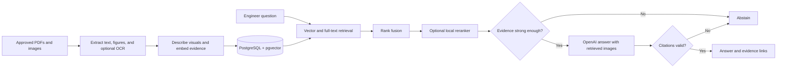

# Scenario 2: Citation-Aware Engineering Chatbot

**A backend for asking questions about approved engineering PDFs and images.**

The service extracts text and figures, indexes them in PostgreSQL with pgvector, retrieves relevant evidence, and asks an OpenAI model to answer with source references. It abstains when the evidence is weak or citations fail validation. This first iteration has no frontend.

| At a glance | |
| --- | --- |
| Inputs | PDF, PNG, JPG/JPEG, and WEBP |
| Retrieval | Vector search + PostgreSQL full-text search + Reciprocal Rank Fusion |
| Optional enhancements | Tesseract OCR and local cross-encoder reranking |
| Output | Answer with document, page, section, and figure references where available |
| Infrastructure | FastAPI, PostgreSQL/pgvector, OpenAI API; Docker Compose runs the database |

## Quick start

You need Python 3.11–3.13, [uv](https://docs.astral.sh/uv/), Docker Desktop or PostgreSQL 16 with pgvector, and an OpenAI API key. Run commands from this repository's root.

**Windows PowerShell**

```powershell
Copy-Item .env.example .env
# Edit .env and set OPENAI_API_KEY
uv sync --extra dev --extra rerank --extra ocr
docker compose up -d postgres
uv run alembic upgrade head
uv run uvicorn app.main:app --reload
```

**Linux/macOS**

```bash
cp .env.example .env
# Edit .env and set OPENAI_API_KEY
uv sync --extra dev --extra rerank --extra ocr
docker compose up -d postgres
uv run alembic upgrade head
uv run uvicorn app.main:app --reload
```

The `rerank` and `ocr` extras are optional. For a smaller installation, use `uv sync --extra dev`. OCR also requires a separate Tesseract installation on `PATH`. Never commit `.env`. Open [the API documentation](http://127.0.0.1:8000/docs) after starting the server.

## Ingest, then ask

Use the CLI to index a file or a directory of supported files:

```powershell
uv run engineering-chatbot ingest C:\papers\pump-study.pdf
uv run engineering-chatbot ingest C:\papers
uv run engineering-chatbot ingest C:\papers --skip-image-descriptions
```

On Linux/macOS, use paths such as `/home/me/papers/pump-study.pdf`. The skip option avoids generating new OpenAI descriptions for extracted images. Figure descriptions otherwise improve visual retrieval but use API tokens. You can also upload a file with `POST /documents`; the default limit is 50 MB.

Ask a question from PowerShell:

```powershell
$body = @{ question = "What does Figure 3 show about pressure and flow rate?" } | ConvertTo-Json
Invoke-RestMethod http://127.0.0.1:8000/chat -Method Post -ContentType 'application/json' -Body $body
```

Or use a POSIX shell:

```bash
curl -X POST http://127.0.0.1:8000/chat \
  -H 'Content-Type: application/json' \
  -d '{"question":"What does Figure 3 show about pressure and flow rate?"}'
```

An answered response has `status: "answered"`, an answer with markers such as `[S1]`, and citation objects. When the evidence is insufficient or citations are invalid, it returns `status: "insufficient_evidence"`, an abstention message, and an empty citation list.

## How it works



**Ingestion.** PyMuPDF extracts page text, embedded images, coordinates, and rendered pages for some vector figures. Optional Tesseract OCR reads scanned text and image labels. An OpenAI vision-capable model describes visual evidence for retrieval. Text and descriptions are embedded with `text-embedding-3-small` by default and stored with document, page, section, figure, and asset metadata. Files are identified by SHA-256; re-ingesting unchanged content is idempotent. Re-ingesting a changed file at the same path replaces its earlier evidence.

**Retrieval.** Vector similarity and PostgreSQL full-text search each return candidates. Reciprocal Rank Fusion combines their ranks without mixing incompatible raw scores. A local cross-encoder reranks the candidate set when its optional dependency is installed; otherwise the system uses the initial retrieval order. The default `RRF_K` is 60 and `RERANK_TOP_K` is 6. The initial database uses exact vector search. An HNSW index should be considered after measuring corpus size, latency, and recall.

**Answering.** The prompt gives the model only retrieved evidence and relevant images. It asks for concise claims with `[S#]` markers, explicit source conflicts, and no estimates of unreadable plot values. A structured response is parsed into Pydantic models. The backend validates returned citations before exposing them. Weak retrieval or invalid citations cause abstention.

## Citations and source inspection

Each retrieved record gets a request-local ID such as `S1`. A citation is accepted only if that ID belongs to the retrieved set, the answer contains its `[S1]` marker, and any supplied text quote appears in the cited evidence after whitespace normalization. A visual citation may have a null quote because image pixels do not provide a literal text span.

The API expands IDs into evidence and document UUIDs, title, page, section, figure label, evidence type, quote, `source_url`, and optional `asset_url`. `source_url` opens the extracted evidence; `asset_url` opens a stored figure or page render. These checks reject invented source IDs and unsupported text quotes. They do **not** prove that every interpretation of a plot is scientifically correct.

## HTTP endpoints

| Endpoint | Purpose |
| --- | --- |
| `GET /health` | Database and OpenAI availability (`ok` or `degraded`). |
| `POST /documents` | Upload and index a supported file; `describe_images` is optional. |
| `GET /documents` | List indexed documents. |
| `GET /documents/{document_id}` | Document metadata. |
| `GET /documents/{document_id}/file` | Original file. |
| `GET /documents/{document_id}/evidence/{evidence_id}` | Extracted source record. |
| `GET /documents/{document_id}/evidence/{evidence_id}/asset` | Figure or rendered page, when available. |
| `POST /chat` | Answer a question with validated citations or abstain. |

Upload from PowerShell:

```powershell
curl.exe -X POST "http://127.0.0.1:8000/documents?describe_images=true" -F "file=@C:\papers\pump-study.pdf"
```

The upload API accepts PDF, PNG, JPG/JPEG, and WEBP and returns HTTP 201 on success. Unsupported extensions return 415; oversized files return 413. The default maximum upload size is 50 MB.

## Configuration

Copy [`.env.example`](.env.example) to `.env` and set `OPENAI_API_KEY`. Key settings include:

| Setting | Default | Meaning |
| --- | --- | --- |
| `DATABASE_URL` | Local PostgreSQL URL | Document and evidence store |
| `OPENAI_CHAT_MODEL`, `OPENAI_VISION_MODEL` | `gpt-4.1-mini` | Answer and figure-description models |
| `OPENAI_EMBED_MODEL` | `text-embedding-3-small` | Evidence and question embeddings |
| `OPENAI_EMBED_DIMENSIONS` | `1536` | Stored vector width |
| `RERANKER_ENABLED` | `true` | Use local cross-encoder when available |
| `RETRIEVAL_CANDIDATES`, `RERANK_TOP_K` | `20`, `6` | Retrieval and final evidence counts |
| `MIN_EVIDENCE_SCORE` | `0.20` | Abstain below this retrieval score |
| `DATA_DIR`, `MAX_UPLOAD_MB` | `data`, `50` | Local storage and upload limit |

Changing the embedding model or dimensions requires a compatible schema migration and re-ingestion of stored evidence. The default threshold is a starting value; tune it using labeled questions from your actual corpus.

## Code map

| Path | Responsibility |
| --- | --- |
| `app/api/routes.py`, `app/schemas.py`, `app/main.py` | HTTP endpoints, contracts, application setup |
| `app/services/extraction.py`, `chunking.py`, `ingestion.py` | Page-aware extraction and indexing |
| `app/services/retrieval.py`, `reranker.py` | Search, fusion, and reranking |
| `app/services/chat.py`, `citations.py`, `openai_provider.py` | Grounded generation and citation checks |
| `app/models.py`, `database.py`, `alembic/` | PostgreSQL persistence and migrations |
| `app/config.py`, `observability.py` | Settings and request tracing |
| `sample_data/`, `tests/` | Demonstration content and deterministic tests |

The `documents` table stores unique files. `evidence_chunks` stores text, figure, page-image, and standalone-image records with locators, visual descriptions, vectors, and a PostgreSQL full-text index.

## Tests and evaluation

```powershell
uv run pytest
```

Unit tests use fakes and do not call the OpenAI API. They cover extraction, chunking, retrieval, citation checks, abstention, and answer behavior. For a real corpus, assemble labeled questions that require text, figures, exact identifiers, conflicting papers, and abstention. Measure retrieval recall separately from answer quality; a plausible answer cannot compensate for a missed source.

Every HTTP response carries an `X-Request-ID`. Logs associate events, timings, selected evidence IDs, and answer status with that ID while excluding raw questions, document text, images, and API credentials.

## Limits and operating considerations

- Uploaded content may be sent to OpenAI for image descriptions or answers. Confirm this is permitted for your data, and budget for ingestion and answer tokens.
- OCR requires a local Tesseract installation. Some vector charts are captured by rendered-page fallback rather than direct figure extraction.
- English full-text search needs adaptation for multilingual corpora. The retrieval threshold needs real-data validation.
- This iteration has no authentication, document-level permissions, background ingestion queue, or frontend. Add access control before exposing it outside a trusted environment.
- The citation validator reduces unsupported references but cannot guarantee that a model read a scientific figure correctly.

Reasonable next steps are access control, background ingestion with job status, a labeled retrieval/answer evaluation suite, scale-driven vector indexing, and a UI that opens citations at the relevant page.
